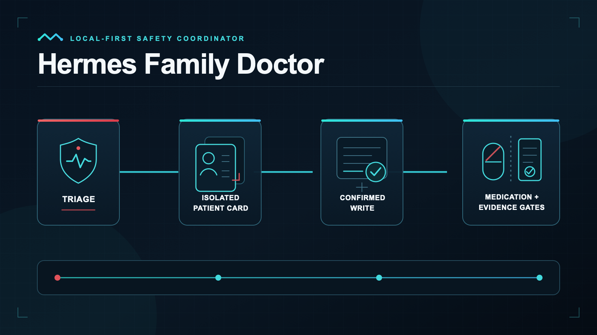
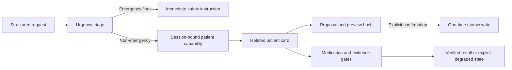

# Hermes Family Doctor

<p align="center">
  
</p>

[](https://github.com/AlekseiUL/hermes-family-doctor/actions/workflows/test.yml)
[](LICENSE)


[English](#english) · [Русский](#russian)

<a id="english"></a>

## English

**A local-first engineering safety core for coordinating family health information with urgency-first routing, isolated patient records, confirmed writes, and bounded public evidence.**

Hermes Family Doctor provides deterministic guardrails around a medical-information workflow. It keeps each patient in a separate namespace, evaluates urgency before attempting record access, requires a preview and one-time confirmation for durable writes, and keeps missing evidence visibly incomplete.

This project is not a physician, medical device, diagnosis service, treatment prescriber, emergency dispatcher, or clinically validated system. A rule miss is never proof of safety. If symptoms may be urgent, contact local emergency services or a qualified clinician.

### Safety flow



Emergency output does not wait for patient storage, a network source, or a model call. A deterministic urgency result may be raised, but not lowered, by a model-facing route.

### What is included in v1.1.0

- adult/child patient boundaries and session-bound capabilities;
- deterministic `fail-safe-1.1` request routing with a non-downgrade urgency floor;
- illness-course open/continue/resolve lifecycle with explicit linkage;
- proposal → preview hash → one-time confirmation receipt → atomic write;
- medication hard stops, duplicate-active-ingredient detection, and incomplete-coverage states;
- optional owner-supplied SQLite interaction signal provider; no interaction dataset is bundled;
- 19 catalogued medical sources: 13 executable no-key sources and 6 catalog-only sources;
- 165 natural-language routing cases, a 200-case synthetic contract pool, and 13 evaluation tests;
- a narrow Hermes plugin/template with raw terminal, file, web, and memory surfaces excluded from the recommended profile.

The repository contains only synthetic examples and evaluation cases. It does not contain patient records, credentials, private runtime state, downloaded medical datasets, or a drug-interaction database.

### Install as a Hermes Agent plugin

Requires a current [Hermes Agent](https://hermes-agent.nousresearch.com/docs) installation. Use a dedicated profile rather than adding medical-record access to a general-purpose agent:

```bash
hermes profile create familydoctor --no-skills --no-alias
hermes --profile familydoctor setup model
hermes --profile familydoctor plugins install AlekseiUL/hermes-family-doctor --enable
hermes --profile familydoctor config set agent.disabled_toolsets '["terminal","file","web","browser","code_execution","computer_use","memory","session_search","delegation","cronjob","messaging","image_gen","video_gen","tts"]'
hermes --profile familydoctor plugins list --enabled --no-bundled --plain
```

The Git plugin directly registers the `family_health` tools, namespaced skills, and a compact urgency-first safety contract. It does not copy a patient database, import private records, or restart a gateway. Configure messaging only after the local verification steps in `docs/HERMES_INTEGRATION.md` pass.

### Install the optional Python CLI

Requires Python 3.11 or newer.

```bash
python3 -m venv .venv
. .venv/bin/activate
python -m pip install "git+https://github.com/AlekseiUL/hermes-family-doctor.git@v1.1.0"
hermes-family-doctor status
```

`status` reports package capabilities without opening a patient database. The expected safety boundary includes `clinician_validated: false` and incomplete interaction coverage unless you configure an approved provider.

For development from a checkout:

```bash
git clone https://github.com/AlekseiUL/hermes-family-doctor.git
cd hermes-family-doctor
python3 -m venv .venv
. .venv/bin/activate
python -m pip install -e '.[dev]'
```

### 5-minute synthetic golden path

Create a new database outside the checkout and run the bundled emergency fixture:

```bash
hermes-family-doctor --db /tmp/hfd-smoke.sqlite3 init
hermes-family-doctor --db /tmp/hfd-smoke.sqlite3 intake \
  --file examples/synthetic-emergency-intake.json \
  --actor local-operator --session smoke-001
```

Expected behavior: the output contains an `emergency_now` urgency level, `patient_context_authorized: false`, and an immediate emergency instruction. The tool does not call emergency services. Delete this synthetic database when you are finished; never put real records inside the repository.

To inspect all public commands and options:

```bash
hermes-family-doctor --help
hermes-family-doctor intake --help
hermes-family-doctor export-runtime-template --help
```

### Patient-card write protocol

1. Select exactly one patient with the `record_update` purpose.
2. Propose one structured fact.
3. Show the returned preview and preserve its `pending_id` and `preview_hash`.
4. Issue a short-lived confirmation receipt only after explicit user confirmation.
5. Confirm the exact pending payload once. Changed payloads, sessions, actors, patients, expired receipts, and replay are rejected.

See `docs/ONBOARDING.md` for safe local setup and `docs/HERMES_INTEGRATION.md` for the runtime template.

### Safety model

| Boundary | Enforced behavior |
|---|---|
| Urgency first | Deterministic triage runs before patient-card access; emergency output is independent of storage and network availability. |
| Patient isolation | Capabilities bind patient, actor, session, purpose, operations, and expiry. Cross-patient reuse fails. |
| Confirmed writes | Durable facts require proposal, exact preview hash, explicit one-time receipt, and atomic confirmation. |
| Medication caution | Hard stops and duplicate-ingredient signals remain separate from overall medication clearance. |
| Evidence minimization | Typed routes accept controlled concepts or ingredient IDs, not raw patient text. |
| Fail-closed degradation | Missing storage authorization, source results, interaction coverage, or required context remains unresolved rather than becoming safe. |

These are engineering contracts, not proof of clinical correctness. Independent clinician review is required before any real-world use.

### Evidence sources

`source_registry.py` contains the source owner, purpose, limitations, allowlisted hosts, and runtime state. Executable sources are WHO, CDC, USPSTF, RCH, PubMed, NCBI E-utilities, PMC, DailyMed, openFDA, RxNorm, EMA, LactMed, and ClinicalTrials.gov. NICE, Cochrane, LOINC, SNOMED CT, ICD-11, and HL7 FHIR are catalog-only by design.

Only controlled concept or ingredient IDs may enter search routes. Never send patient names, IDs, dates of birth, contacts, addresses, or raw clinical text. Network results are untrusted evidence. Empty or failed retrieval remains degraded; it is not converted into negative clearance.

### Optional interaction signal

Set `FAMILY_HEALTH_DDI_SQLITE` to an owner-approved database matching the schema documented in `docs/INTERACTION_PROVIDER.md`. The base package remains useful without it and reports `coverage_incomplete`. DDInter data and its importer are intentionally not bundled because its upstream licensing is separate from this repository.

No absent interaction row clears a medication. Food, supplement, allergy, disease, dose, timing, pregnancy, renal, hepatic, and formulation risks remain separate review dimensions.

### Hermes Agent integration

The repository root is directly installable with `hermes plugins install`. The bundled `runtime-template/` remains review material for maintainers who need to inspect or manually stage the same tools and skills. Neither path copies a database or restarts a gateway.

```bash
hermes-family-doctor export-runtime-template --target /tmp/hfd-runtime-review
```

Review the exported files before any manual merge. The export command refuses an existing target. The recommended profile exposes the `family_health` plugin while high-blast-radius terminal, file, memory, raw web, browser, and cross-agent toolsets are explicitly disabled in `config.example.yaml` and the quick-install command above.

Hermes Agent upstream: https://github.com/NousResearch/hermes-agent

### Testing and evaluation

```bash
python -m compileall -q __init__.py src evaluation tests runtime-template
python -m pytest -q
python evaluation/runner.py --all --report /tmp/hfd-contract-summary.json
python scripts/privacy_scan.py .
```

The v1.1.0 release gate covers 115 unit/integration tests, including 165 natural-language routing cases, direct Hermes-plugin registration, fixture-privacy policy, and two installed-export path regressions, plus 13 evaluation-harness tests and a 200-case synthetic contract pool. These checks use synthetic data and do not establish clinical accuracy or clinical validation. The public regression split is visible by design; it is not a sealed holdout.

CI runs compile checks, tests on Python 3.11–3.13, package build, archive inspection, normal wheel installation, installed CLI smoke, and the repository privacy scanner. Public source endpoints are deliberately excluded from CI because availability changes.

### Limitations

- No independent blinded clinician validation has been completed.
- The urgency rules are an engineering prototype; a missed rule is not proof of safety.
- The tool does not call emergency services, diagnose, prescribe, or calculate pediatric or prescription dosing.
- The base package has no complete drug-interaction dataset and cannot provide negative interaction clearance.
- Network evidence can be unavailable, incomplete, outdated, jurisdiction-limited, or wrong.
- PDF ingestion is not implemented; do not treat arbitrary PDFs as safe structured input.
- The public regression cases are inspectable and therefore are not a sealed clinical holdout.
- Hermes configuration evolves; verify the template against the current Hermes documentation before activation.

### Roadmap

- Add an explicitly bounded PDF intake path with parser isolation, provenance, and human preview.
- Expand synthetic negative and degraded-state coverage without turning public cases into clinical claims.
- Stabilize package and receipt schemas before leaving alpha.
- Prepare a separate blinded clinician-review protocol; do not infer validation from engineering tests.

Roadmap items are intentions, not delivery promises.

### Install, uninstall, rollback

Installation is local and does not activate messaging or restart a gateway. The installed wheel can export its bundled template to a new directory with `hermes-family-doctor export-runtime-template --target /tmp/hfd-runtime-review`; it refuses to overwrite an existing target. To uninstall:

```bash
python -m pip uninstall hermes-family-doctor
hermes --profile familydoctor plugins remove hermes-family-doctor
```

Before replacing a database or runtime template, copy it to a private backup location and verify the copy. Rollback means uninstalling the package, restoring the prior template/database from that backup, and restarting a gateway only under your normal change-control process. This repository never performs an automatic restart.

<a id="russian"></a>

## Русский

### Что это

**Hermes Family Doctor — локальное инженерное ядро безопасности для координации медицинской информации семьи.** Оно изолирует карточки пациентов, проверяет срочность до чтения истории, не позволяет модели понизить детерминированный уровень срочности, применяет изменения карточки только после явного подтверждения и сохраняет нехватку доказательств как явное ограничение.

Это не врач, не медицинское устройство, не сервис диагностики, не система назначения лечения и не диспетчер экстренной службы. Клиническая валидация не проводилась. Отсутствие срабатывания правила не означает безопасность. При возможной срочной ситуации обращайтесь в местную экстренную службу или к квалифицированному врачу.

### Как устроен контур

1. Структурированный запрос сначала проходит детерминированную проверку срочности.
2. Экстренная инструкция не зависит от базы, сети или ответа модели.
3. Для несрочной работы выдаётся ограниченная capability на одного пациента, одну сессию, цель и список операций.
4. Изменение карточки проходит через предложение, preview hash и одноразовое подтверждение.
5. Лекарственные и evidence-проверки возвращают либо проверенный сигнал, либо явное состояние неполного покрытия.

### Возможности v1.1.0

- отдельные пространства взрослых и детских карточек;
- маршрутизатор `fail-safe-1.1` с запретом понижения срочности;
- ведение эпизода болезни: открыть, продолжить, отметить восстановление или завершить;
- атомарная запись только после точного preview и одноразового receipt;
- medication hard stops, поиск дублирования действующего вещества и явное неполное покрытие;
- 19 описанных медицинских источников: 13 исполняемых no-key routes и 6 catalog-only;
- проверяемый Hermes template без автоматического изменения профиля;
- только синтетические примеры и evaluation cases — без реальных карточек и медицинских баз.

### Установка в Hermes Agent

Нужна актуальная версия [Hermes Agent](https://hermes-agent.nousresearch.com/docs). Используйте отдельный профиль, а не добавляйте медицинские карточки в универсального агента:

```bash
hermes profile create familydoctor --no-skills --no-alias
hermes --profile familydoctor setup model
hermes --profile familydoctor plugins install AlekseiUL/hermes-family-doctor --enable
hermes --profile familydoctor config set agent.disabled_toolsets '["terminal","file","web","browser","code_execution","computer_use","memory","session_search","delegation","cronjob","messaging","image_gen","video_gen","tts"]'
hermes --profile familydoctor plugins list --enabled --no-bundled --plain
```

Git plugin напрямую регистрирует инструменты `family_health`, namespaced skills и компактный safety-контракт «сначала срочность». Установка не копирует базу пациентов, не импортирует приватные записи и не перезапускает gateway. Подключайте Telegram или другой messaging surface только после локальной проверки из `docs/HERMES_INTEGRATION.md`.

### Установка опционального Python CLI

Нужен Python 3.11 или новее.

```bash
python3 -m venv .venv
. .venv/bin/activate
python -m pip install "git+https://github.com/AlekseiUL/hermes-family-doctor.git@v1.1.0"
hermes-family-doctor status
```

Команда `status` показывает возможности пакета, не открывая базу пациента. В корректном публичном состоянии `clinician_validated` остаётся `false`, а покрытие лекарственных взаимодействий — неполным, пока владелец не подключил отдельно проверенный provider.

### Синтетический запуск за 5 минут

```bash
hermes-family-doctor --db /tmp/hfd-smoke.sqlite3 init
hermes-family-doctor --db /tmp/hfd-smoke.sqlite3 intake \
  --file examples/synthetic-emergency-intake.json \
  --actor local-operator --session smoke-001
```

Ожидаемый результат: уровень `emergency_now`, `patient_context_authorized: false` и немедленная инструкция обратиться за экстренной помощью. Система сама не вызывает службу. Не храните реальные карточки в репозитории.

### Модель безопасности

| Граница | Что обеспечивает код |
|---|---|
| Сначала срочность | Triage выполняется до доступа к карточке; модель не может понизить минимальный уровень. |
| Изоляция пациентов | Capability привязана к пациенту, оператору, сессии, цели, операциям и сроку. |
| Подтверждённая запись | Нужны предложение, точный preview hash, явный одноразовый receipt и атомарное подтверждение. |
| Осторожность с лекарствами | Отдельный interaction signal не превращается в общее разрешение принимать препарат. |
| Минимизация данных | Во внешние evidence routes передаются контролируемые ID, а не текст карточки. |
| Fail-closed | Пропуск, ошибка или неполное покрытие остаются нерешённым риском, а не отрицательным результатом. |

### Источники и взаимодействия

Исполняемые no-key routes: WHO, CDC, USPSTF, RCH, PubMed, NCBI E-utilities, PMC, DailyMed, openFDA, RxNorm, EMA, LactMed и ClinicalTrials.gov. NICE, Cochrane, LOINC, SNOMED CT, ICD-11 и HL7 FHIR остаются catalog-only. Сетевой ответ — недоверенное доказательство, а не инструкция.

Опциональный SQLite provider задаётся через `FAMILY_HEALTH_DDI_SQLITE` и должен соответствовать `docs/INTERACTION_PROVIDER.md`. DDInter и его importer не входят в пакет из-за отдельной upstream-лицензии. Отсутствие строки о взаимодействии не означает, что взаимодействия нет.

### Интеграция с Hermes Agent

Корень репозитория устанавливается штатной командой `hermes plugins install`. Для ручного аудита той же интеграции можно экспортировать template:

```bash
hermes-family-doctor export-runtime-template --target /tmp/hfd-runtime-review
```

Экспорт создаёт новую директорию и отказывается перезаписывать существующую. Рекомендуемый профиль оставляет plugin `family_health`, а high-blast-radius toolsets отключает через актуальный `agent.disabled_toolsets`.

### Тестирование

```bash
python -m compileall -q __init__.py src evaluation tests runtime-template
python -m pytest -q
python evaluation/runner.py --all --report /tmp/hfd-contract-summary.json
python scripts/privacy_scan.py .
```

Release gate v1.1.0 включает 115 unit/integration тестов, в том числе 165 естественных формулировок, проверку прямой регистрации Hermes plugin, fixture-privacy policy и два regression-теста installed export path, а также 13 тестов evaluation harness и synthetic contract pool из 200 случаев. Это инженерные контракты на синтетических данных, а не доказательство клинической точности.

### Ограничения

- срочный ответ не вызывает экстренную службу автоматически;
- система не рассчитывает детские или рецептурные дозы;
- отсутствие найденного взаимодействия не является разрешением принимать препарат;
- DDInter и другие базы взаимодействий не входят в пакет;
- PDF ingestion пока не реализован;
- public regression split открыт и не является закрытым клиническим holdout;
- перед реальным применением требуется независимая клиническая проверка.

### План развития

- изолированный и проверяемый PDF intake с provenance и ручным preview;
- больше синтетических negative/degraded-state cases;
- стабильные версии package/receipt schemas до выхода из alpha;
- отдельный blinded clinician-review protocol.

Это направления работы, а не обещание сроков.

### Удаление и откат

```bash
python -m pip uninstall hermes-family-doctor
hermes --profile familydoctor plugins remove hermes-family-doctor
```

Удаление пакета не удаляет медицинскую базу. Перед заменой базы или runtime template создайте приватную проверенную резервную копию. Откат: перестать использовать новый профиль, вернуть записанную предыдущую версию wheel/template/database, выполнить `status` и синтетический smoke, и только затем подключать messaging surface. Автоматического restart или broad delete в проекте нет.

Подробности: `docs/ONBOARDING.md`, `docs/HERMES_INTEGRATION.md`, `docs/INTERACTION_PROVIDER.md`, `SECURITY.md` и `NOTICE.md`.

## Development

```bash
python -m pip install -e '.[dev]'
python -m compileall -q __init__.py src evaluation tests runtime-template
python -m pytest -q
python scripts/privacy_scan.py .
```

CI runs compile, tests, package build, wheel installation, installed CLI smoke, archive inspection, and the repository privacy scanner. Live source canaries are deliberately manual because public endpoints change.

## Contributing and security

Contributions should use synthetic fixtures only, preserve the urgency-first and fail-closed boundaries, and include tests for both successful and degraded paths. Do not open an issue or pull request containing patient data, credentials, private paths, database files, or source dumps.

For vulnerability reports, follow `SECURITY.md` and use a private contact path. The project does not require or accept real patient records for reproduction.

## License and attribution

MIT for repository code. Upstream source content and owner-supplied datasets retain their own terms. See `NOTICE.md`.

## Maintainer

- GitHub: https://github.com/AlekseiUL
- YouTube: https://youtube.com/@alekseiulianov
- Telegram channel: https://t.me/Sprut_AI
- Telegram community: https://t.me/+eH-qNIDmud8zNDZi
